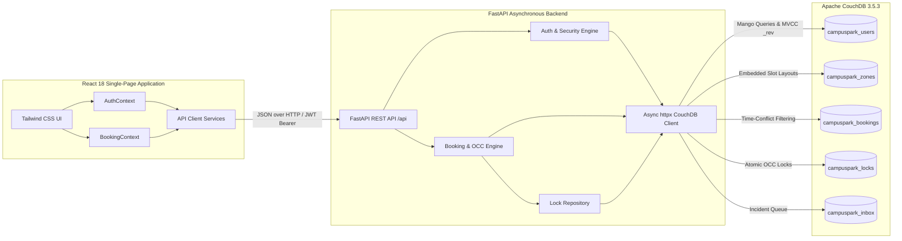

# CampusPark — Full-Stack University Parking Management System

**NoSQL Database Subject Implementation & UI/UX Capstone**  
**Architecture:** React 18 (Vite + Tailwind CSS) → FastAPI (Python 3.12 Asynchronous REST API) → Apache CouchDB 3.5.3 (MVCC Document Store)  
**Database Host:** `http://127.0.0.1:5984` | **Backend API:** `http://127.0.0.1:8000` | **Frontend App:** `http://localhost:5173`

---

## 1. Project Overview

CampusPark has been transformed from a frontend-only prototype into an end-to-end full-stack campus parking reservation system powered by **Apache CouchDB** as the primary persistent database.

The application serves students, faculty, staff, visitors, and campus facilities administrators with real-time zone availability tracking, an interactive visual slot map, multi-criteria filtering (EV charging, ADA accessible, covered parking), server-side double-booking prevention, digital parking pass generation (`.ics` calendar export), and administrative maintenance controls.



---

## 2. Technology Stack & Key Highlights

### Frontend
- **Framework:** React 18 with Vite build tooling
- **Styling:** Custom Tailwind CSS (design tokens, color palettes, dark mode support)
- **Icons:** `lucide-react` (uniform 2px stroke weight)
- **Routing:** React Router DOM v6 with `ProtectedRoute` and `RoleRoute`
- **State:** React Context API (`AuthContext`, `BookingContext`, `ToastContext`, `ThemeContext`)
- **API Communication:** Standardized fetch API client with automatic JWT token attachment, 401 interceptors, and error normalization.

### Backend
- **Framework:** Python 3.12 + FastAPI
- **Server:** Uvicorn ASGI server with hot-reload
- **Security:** Bcrypt password hashing (`salt rounds=12`) & Python-Jose JWT signing (`HS256`)
- **HTTP Client:** Asynchronous `httpx` connection pool to CouchDB
- **Data Validation:** Pydantic v2 schemas and models

### NoSQL Database (Apache CouchDB 3.5.3)
- **Storage Model:** Multi-Version Concurrency Control (MVCC) document database
- **Revisions:** Revision CAS (`_rev`) prevents dirty writes and lost updates
- **Query Engine:** Mango queries (`_find`) powered by custom JSON B-Tree indexes
- **Concurrency Control:** Distributed lease documents in `campuspark_locks` for atomic booking coordination

---

## 3. Demo Credentials (One-Click Autofill Enabled)

All demo accounts are seeded directly into CouchDB with secure bcrypt hashes:

| Role | Demo Email | Demo Password | Permit Type |
| :--- | :--- | :--- | :--- |
| **Student** | `student@campus.edu` | `Student@2026` | Semester Student Pass #STU-9921 |
| **Faculty** | `faculty@campus.edu` | `Faculty@2026` | Faculty Reserved Pass #FAC-4402 |
| **Admin** | `admin@campus.edu` | `Admin@2026` | Campus Operations Administrator |
| **Staff** | `staff@campus.edu` | `Staff@2026` | Staff Parking Permit #STF-3011 |
| **Visitor** | `visitor@guest.edu` | `Visitor@2026` | Visitor Day Pass #VIS-1002 |

> *Guest Mode:* Visitors can click **"Continue as Visitor (Browse Only)"** to explore zones and maps without an account, and are guided to authenticate when confirming a bay reservation.

---

## 4. Quick Start & Execution Guide

### Prerequisites
- **Apache CouchDB 3.5.3** running locally on port `5984`
- **Python 3.10+** (Python 3.12 configured in `backend/venv`)
- **Node.js 18+** with `npm`

---

### Step 1: Start Apache CouchDB
Ensure the Apache CouchDB Windows Service is running:
- URL: `http://127.0.0.1:5984`
- Username: `admin`
- Password: `123456` (configured in `backend/.env`)

Verify CouchDB in PowerShell:
```powershell
curl http://127.0.0.1:5984/
```
Expected output:
```json
{"couchdb":"Welcome","version":"3.5.3",...}
```

---

### Step 2: Seed the CouchDB Database
To initialize all five CouchDB databases (`campuspark_users`, `campuspark_zones`, `campuspark_bookings`, `campuspark_locks`, `campuspark_inbox`), Mango indexes, and demo records:

**Option A (Windows batch file):**
```cmd
double-click seed-database.bat
```

**Option B (PowerShell):**
```powershell
cd backend
$env:PYTHONPATH = (Get-Location).Path
.\venv\Scripts\python.exe -m app.scripts.seed_database
```

---

### Step 3: Run the FastAPI Backend
Start the backend server on `http://127.0.0.1:8000`:

**Option A (Windows batch file):**
```cmd
double-click run-backend.bat
```

**Option B (PowerShell):**
```powershell
cd backend
$env:PYTHONPATH = (Get-Location).Path
.\venv\Scripts\uvicorn.exe app.main:app --host 127.0.0.1 --port 8000 --reload
```

- Interactive OpenAPI Swagger Docs: [http://127.0.0.1:8000/docs](http://127.0.0.1:8000/docs)
- Health check: [http://127.0.0.1:8000/api/health](http://127.0.0.1:8000/api/health)

---

### Step 4: Run the React Frontend
In a new terminal, launch the Vite development server:

**Option A (Windows batch file):**
```cmd
double-click run-frontend.bat
```

**Option B (PowerShell):**
```powershell
cd campuspark
npm run dev
```

Open your browser to: [http://localhost:5173](http://localhost:5173)

---

## 5. Running the Backend Test Suite

The backend includes a comprehensive pytest suite covering health checks, authentication, authorization, role restrictions, zone and slot management, double-booking prevention, and CouchDB optimistic locking:

```powershell
cd backend
$env:PYTHONPATH = (Get-Location).Path
.\venv\Scripts\pytest.exe tests -v
```

**Results:**
```
backend/tests/test_auth.py::test_auth_login_success PASSED
backend/tests/test_auth.py::test_auth_login_invalid_password PASSED
backend/tests/test_auth.py::test_auth_prevent_admin_self_registration PASSED
backend/tests/test_auth.py::test_auth_register_and_get_me PASSED
backend/tests/test_bookings.py::test_booking_creation_and_double_booking_prevention PASSED
backend/tests/test_health.py::test_health_endpoint PASSED
backend/tests/test_zones.py::test_get_all_zones PASSED
backend/tests/test_zones.py::test_get_single_zone PASSED
backend/tests/test_zones.py::test_update_slot_status_admin_auth PASSED

======================== 9 passed in 17s ========================
```

---

## 6. REST API Reference

| Method | Endpoint | Description | Auth Required |
| :--- | :--- | :--- | :--- |
| `GET` | `/api/health` | Check operational health and CouchDB connection | No |
| `POST` | `/api/auth/register` | Register student, faculty, staff, or visitor account | No |
| `POST` | `/api/auth/login` | Authenticate with credentials and receive JWT | No |
| `GET` | `/api/auth/me` | Fetch currently authenticated user profile | Bearer JWT |
| `POST` | `/api/auth/logout` | Client session disposal endpoint | Bearer JWT |
| `GET` | `/api/users/me` | Get user profile and vehicle records | Bearer JWT |
| `PUT` | `/api/users/me` | Update user department, profile metadata | Bearer JWT |
| `PUT` | `/api/users/me/vehicles`| Add or update registered vehicles | Bearer JWT |
| `GET` | `/api/zones` | Retrieve all 6 parking zones with live slot status | No |
| `GET` | `/api/zones/{id}` | Retrieve specific parking zone details | No |
| `POST` | `/api/zones` | Create a new campus parking lot | Admin only |
| `PUT` | `/api/zones/{id}` | Update parking zone details | Admin only |
| `PATCH`| `/api/zones/{id}/slots/{slot_id}/status` | Update slot status (`available`, `occupied`, `disabled`) | Admin only |
| `POST` | `/api/zones/{id}/slots` | Add a new parking slot to a zone | Admin only |
| `POST` | `/api/bookings` | Create reservation with overlap & lock validation | Bearer JWT |
| `GET` | `/api/bookings/my` | Retrieve bookings owned by current user | Bearer JWT |
| `GET` | `/api/bookings` | View all campus bookings (Admin) or personal (User) | Bearer JWT |
| `PATCH`| `/api/bookings/{id}/cancel` | Cancel booking with reason and audit timestamp | Bearer JWT |
| `PATCH`| `/api/bookings/{id}/restore`| Undo cancellation / restore active booking | Bearer JWT |
| `GET` | `/api/dashboard/stats` | Campus-wide occupancy & EV capacity metrics | No |
| `GET` | `/api/dashboard/my-summary` | Upcoming reservation preview and counter stats | Bearer JWT |
| `GET` | `/api/admin/inbox` | List security patrol and maintenance incident reports | Admin only |
| `PATCH`| `/api/admin/inbox/{id}/resolve` | Mark safety report as resolved | Admin only |
| `POST` | `/api/admin/reset-demo` | Restore clean academic demo seeds across all DBs | Admin only |

---

## 7. NoSQL Architecture Documentation

For complete academic and technical documentation on:
- CouchDB document schema designs
- Embedding vs. referencing modeling trade-offs
- Mango query indexes and query performance
- Multi-Version Concurrency Control (MVCC) and `_rev` CAS mechanism
- Distributed lock coordination in `campuspark_locks`
- Double-booking prevention algorithm

Please refer to:  
👉 **[documentation/nosql-design.md](documentation/nosql-design.md)**

---

## 8. Living UI/UX Styleguide

The application includes an integrated design system reference route at:  
👉 **`http://localhost:5173/styleguide`**

Showcases color tokens, typography scales, Nielsen usability heuristics mapping, Fitts's Law touch targets, WCAG AA contrast compliance scores, and interactive component states.
