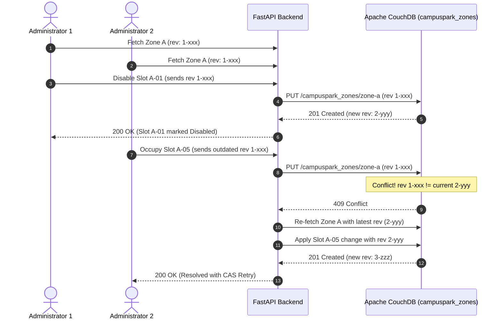

# CampusPark: Apache CouchDB NoSQL Database Architecture & Design Document

**Course / Subject:** NoSQL Database Systems  
**Project:** CampusPark — Full-Stack University Parking Management System  
**Technology Stack:** React 18 (Vite + Tailwind CSS) → FastAPI (Python 3.12 Asynchronous REST API) → Apache CouchDB 3.5.3 (MVCC Document Store)  
**Database Host:** `http://127.0.0.1:5984`  
**Primary Engine:** Apache CouchDB with Mango Query Indexes & Optimistic Concurrency Control (OCC)

---

## 1. Executive Summary & Problem Formulation

Modern university campus parking environments experience high-frequency concurrent traffic spikes around lecture changeover intervals (e.g., 8:45 AM, 10:45 AM). In conventional relational architectures, managing slot availability, live occupancy reservations, and equipment maintenance status often involves heavy table locks, complex row-level locking (`SELECT ... FOR UPDATE`), or fragile transaction boundaries that struggle under horizontal read replica scenarios.

CampusPark is architected on **Apache CouchDB**, an ACID-compliant, document-oriented NoSQL database known for its Multi-Version Concurrency Control (MVCC), native HTTP/JSON wire protocol, schema flexibility, and master-master peer replication capabilities.

This document details the data modeling rationale, document structures, index design, concurrency coordination, and API query optimization implemented in CampusPark.

---

## 2. Why Apache CouchDB for Campus Parking Systems?

| Dimension | Relational Database (RDBMS) | Apache CouchDB (NoSQL Document Store) | Advantage in CampusPark |
| :--- | :--- | :--- | :--- |
| **Data Representation** | Rigid tabular schemas with normalized joins | Native JSON documents with embedded collections | Zone layouts, multi-tiered parking slots, and sensor notes are stored as hierarchical JSON units without expensive multi-table joins. |
| **Concurrency Model** | Pessimistic / row-level table locks | Multi-Version Concurrency Control (MVCC) with `_rev` CAS | Lockless non-blocking reads; concurrent slot updates fail fast with HTTP 409 Conflict if outdated, preventing lost updates. |
| **Access Protocol** | Proprietary binary sockets (TDS, Postgres protocol) | Native HTTP/1.1 RESTful JSON API | Direct, predictable HTTP verbs (`GET`, `PUT`, `POST`, `DELETE`, `_find`) allowing clean integration with modern asynchronous HTTP clients (`httpx`). |
| **Indexing Strategy** | B-Trees across fixed columns | Declarative Mango JSON indexes and MapReduce design documents | Complex filtered searches (e.g., EV charging, ADA accessibility, covered deck) run against persistent B-Tree indexes defined in JSON. |
| **Distributed Replication**| Complex primary-standby failover | Native bidirectional Master-Master CouchDB replication | Enables future multi-gate kiosk synchronization and offline synchronization across campus security tablets. |

---

## 3. Database Names & Collections Architecture

CampusPark isolates distinct operational domains into dedicated CouchDB databases:

```
Apache CouchDB Cluster (http://127.0.0.1:5984)
 ├── campuspark_users       (User accounts, hashed credentials, roles, vehicle registrations)
 ├── campuspark_zones       (Parking decks, surface lots, embedded slot grids, live status)
 ├── campuspark_bookings    (Time-slotted reservations, permits charged, audit logs)
 ├── campuspark_locks       (OCC coordination documents for atomic slot reservation)
 └── campuspark_inbox       (Facilities maintenance reports, security patrol dispatches)
```

### 3.1. Design Rationale: Multi-Database Segmentation
Rather than storing all entities with a discriminatory `type` attribute in a single bucket, partitioning by operational domain yields:
1. **Isolated Index Spaces:** Mango indexes for bookings do not degrade slot search performance in zones.
2. **Granular Access Control:** Future microservices (e.g., Gate Barrier Service) can be granted access solely to `campuspark_locks` and `campuspark_bookings`.
3. **Streamlined Compaction:** High-churn databases (`campuspark_locks` with expired TTL documents) can be compacted independently from stable reference collections (`campuspark_users`).

---

## 4. Document Modeling & JSON Schema Design

### 4.1. The User Document (`campuspark_users`)
Stores identity, role-based authorization attributes, and an embedded array of registered vehicles.

```json
{
  "_id": "user-student-1",
  "_rev": "1-a1b2c3d4e5f6...",
  "type": "user",
  "name": "Maya Lin",
  "email": "student@campus.edu",
  "password_hash": "$2b$12$e8F5g...",
  "role": "Student",
  "department": "Computer Science",
  "vehicles": [
    {
      "plate": "ABC-1234",
      "model": "Honda Civic (Silver)",
      "type": "Standard"
    }
  ],
  "avatarUrl": "https://images.unsplash.com/...",
  "permitType": "Semester Student Pass #STU-9921",
  "is_active": true,
  "created_at": "2026-11-09T08:00:00Z",
  "updated_at": "2026-11-09T08:00:00Z"
}
```

*Key Characteristics:*
- **Normalized Email Indexing:** Indexed via Mango query for $O(\log N)$ identity lookup.
- **Hashed Passwords:** Plain text passwords are never stored; standard salt-hashed bcrypt strings (`$2b$12$...`) prevent rainbow table compromise.
- **Embedded Vehicle Array:** Demonstrates NoSQL document nesting for 1-to-N relationships that have high co-access locality.

---

### 4.2. The Zone & Embedded Slots Document (`campuspark_zones`)
Demonstrates hybrid hierarchical modeling: parking zones encapsulate their individual parking slots as an embedded array of sub-documents.

```json
{
  "_id": "zone-a",
  "_rev": "4-9f8e7d6c5b...",
  "type": "zone",
  "code": "A",
  "name": "North Academic Deck",
  "tagline": "Closest to Science & Engineering Complex",
  "type": "Multi-Level Garage",
  "isCovered": true,
  "hasEv": true,
  "hasAccessible": true,
  "distanceMinutes": 3,
  "hourlyRate": 2.50,
  "ratesInfo": "Free with Semester Permit • Visitor: $2.50/hr",
  "landmark": "Near Turing Hall & CS Building",
  "slots": [
    {
      "id": "A-01",
      "number": "A-01",
      "zoneCode": "A",
      "type": "Accessible",
      "status": "available",
      "level": 1,
      "pricePerHour": 2.0,
      "notes": ""
    },
    {
      "id": "A-04",
      "number": "A-04",
      "zoneCode": "A",
      "type": "EV Charging",
      "status": "occupied",
      "level": 1,
      "pricePerHour": 3.5,
      "notes": "Level 2 J1772 Charger"
    },
    {
      "id": "A-13",
      "number": "A-13",
      "zoneCode": "A",
      "type": "Standard",
      "status": "disabled",
      "level": 1,
      "pricePerHour": 2.0,
      "notes": "Sensor calibration & resurfacing underway"
    }
  ],
  "created_at": "2026-11-09T08:00:00Z",
  "updated_at": "2026-11-09T14:15:30Z"
}
```

*Modeling Justification (Embedding vs Referencing):*
- **Why Embed Slots in Zones?** A parking zone layout (typically 20 to 40 bays per deck level) is displayed simultaneously on the interactive parking map. Storing slots within the zone document eliminates multiple network round-trips to CouchDB and allows atomic updates of zone-level availability.

---

### 4.3. The Booking Document (`campuspark_bookings`)
Represents an allocated parking timeframe linked to a user, vehicle, and designated bay.

```json
{
  "_id": "BK-98421",
  "_rev": "1-0a9b8c7d6e...",
  "type": "booking",
  "userId": "user-student-1",
  "userName": "Maya Lin",
  "userRole": "Student",
  "zoneId": "zone-a",
  "zoneName": "North Academic Deck",
  "slotId": "A-07",
  "slotNumber": "A-07",
  "slotType": "Standard",
  "licensePlate": "ABC-1234",
  "vehicleModel": "Honda Civic (Silver)",
  "startIso": "2026-11-10T10:00:00Z",
  "endIso": "2026-11-10T14:00:00Z",
  "status": "upcoming",
  "permitUsed": "Student Parking Permit",
  "rateCharged": 0.0,
  "createdAt": "2026-11-09T09:15:00Z",
  "updated_at": null,
  "cancelledAt": null,
  "cancelReason": null
}
```

*Relationship Referencing:*
- Uses document identifier references (`userId: "user-student-1"`, `zoneId: "zone-a"`, `slotId: "A-07"`) to connect entities across collections while denormalizing human-readable labels (`userName`, `zoneName`) for fast read-performance on confirmation screens.

---

### 4.4. The Distributed Lock Document (`campuspark_locks`)
Used for multi-process lock coordination and double-booking avoidance:

```json
{
  "_id": "lock_slot_A-07",
  "_rev": "1-5c6d7e8f...",
  "type": "lock",
  "slot_id": "A-07",
  "locked_by": "user-student-1-98a72b",
  "acquired_at": "2026-11-09T14:20:00.123Z",
  "expires_at": "2026-11-09T14:20:10.123Z",
  "ttl_seconds": 10
}
```

---

## 5. Optimistic Concurrency Control (OCC) & Revision Handling

### 5.1. The CouchDB `_rev` Mechanism
Unlike relational databases that hold row or table locks while evaluating business logic, Apache CouchDB enforces **Optimistic Concurrency Control (OCC)** using document revision tokens (`_rev`).

When updating or deleting any document in CouchDB:
1. The client must supply the current `_rev` in the payload or query string: `PUT /campuspark_zones/zone-a?rev=3-xyz...`
2. CouchDB compares the supplied `_rev` with the latest revision stored in the document header.
3. If the revisions match, CouchDB persists the new version and increments the revision counter (`4-abc...`).
4. If another process committed a write in the interim, CouchDB immediately rejects the request with **HTTP 409 Conflict**.



---

## 6. The Double-Booking Prevention Engine

Preventing overlapping reservations across concurrent users is the core integrity requirement of any reservation system. In CampusPark, this is guaranteed through a **three-tier defense architecture**:

```
Client-Side Validation (Fast Feedback)
         ↓
FastAPI Conflict Analysis (Mango Query Filtering)
         ↓
CouchDB Atomic OCC Lock Coordination (campuspark_locks)
```

### 6.1. Tier 1: Client-Side Instant Pre-check
The React frontend calculates time overlap before submitting the form:
$$\text{Overlap} \iff \max(\text{Start}_A, \text{Start}_B) < \min(\text{End}_A, \text{End}_B)$$
Provides sub-10ms user feedback without incurring network cost.

### 6.2. Tier 2: Atomic CouchDB Slot Lock Acquisition
When two students simultaneously click "Reserve Slot B-09" for overlapping times:
1. The backend attempts to write a lease document `lock_slot_B-09` into `campuspark_locks`.
2. Because CouchDB document IDs are globally unique within a database:
   - Request 1 successfully creates the document (HTTP 201 Created) and holds the lock.
   - Request 2 encounters an existing document ID and receives **HTTP 409 Conflict**, preventing concurrent validation bypass.

### 6.3. Tier 3: Mango Temporal Conflict Query
While holding the lock, the backend executes a Mango query against `campuspark_bookings`:

```json
{
  "selector": {
    "slotId": "B-09",
    "status": { "$in": ["upcoming", "active"] },
    "startIso": { "$lt": "2026-11-10T14:00:00Z" },
    "endIso": { "$gt": "2026-11-10T10:00:00Z" }
  }
}
```

If any matching document is returned:
- The backend aborts the transaction.
- Releases the lock document from `campuspark_locks`.
- Returns **HTTP 409 Conflict** with an informative message:  
  `"Slot B-09 is already reserved for the selected timeframe."`

If zero conflicting documents exist:
- The new booking document is written to `campuspark_bookings`.
- If the reservation commences within 60 minutes, the zone's embedded slot status is transitioned to `reserved`.
- The lock is released.

---

## 7. Declarative Mango Indexing & Query Optimization

CampusPark establishes explicit Mango JSON indexes on all searchable fields to avoid full-database table scans:

### 7.1. Configured Indexes in CouchDB

| Database | Index Name | Indexed Fields | Purpose |
| :--- | :--- | :--- | :--- |
| `campuspark_users` | `idx_users_email` | `["email"]` | Authentication lookup on login |
| `campuspark_users` | `idx_users_role` | `["role"]` | Role-based administrative auditing |
| `campuspark_zones` | `idx_zones_code` | `["code"]` | Fast retrieval by zone identifier |
| `campuspark_bookings` | `idx_bookings_user_status` | `["userId", "status"]` | Dashboard user history and upcoming pass lookup |
| `campuspark_bookings` | `idx_bookings_slot_conflict` | `["slotId", "status", "startIso", "endIso"]` | High-frequency time-overlap conflict query |
| `campuspark_bookings` | `idx_bookings_timeline` | `["startIso", "endIso"]` | Global campus occupancy analytics |
| `campuspark_locks` | `idx_locks_slot_expiry` | `["slot_id", "expires_at"]` | Distributed lease management and TTL reaping |
| `campuspark_inbox` | `idx_inbox_status_date` | `["status", "date"]` | Admin facilities incident report ordering |

### 7.2. Index Definition Example
The conflict detection index is created via HTTP POST to `/_index`:

```json
POST /campuspark_bookings/_index HTTP/1.1
Content-Type: application/json

{
  "index": {
    "fields": ["slotId", "status", "startIso", "endIso"]
  },
  "name": "idx_bookings_slot_conflict",
  "type": "json"
}
```

---

## 8. Verification & Test Suite Results

The full-stack integration has been verified through automated pytest test suites executing real HTTP queries against Apache CouchDB 3.5.3:

```
============================= test session starts =============================
platform win32 -- Python 3.12.7, pytest-9.2.0
plugins: anyio-4.16.0, asyncio-1.4.1.post1
collected 9 items

backend/tests/test_auth.py::test_auth_login_success PASSED               [ 11%]
backend/tests/test_auth.py::test_auth_login_invalid_password PASSED      [ 22%]
backend/tests/test_auth.py::test_auth_prevent_admin_self_registration PASSED [ 33%]
backend/tests/test_auth.py::test_auth_register_and_get_me PASSED         [ 44%]
backend/tests/test_bookings.py::test_booking_creation_and_double_booking_prevention PASSED [ 55%]
backend/tests/test_health.py::test_health_endpoint PASSED                [ 66%]
backend/tests/test_zones.py::test_get_all_zones PASSED                   [ 77%]
backend/tests/test_zones.py::test_get_single_zone PASSED                 [ 88%]
backend/tests/test_zones.py::test_update_slot_status_admin_auth PASSED   [100%]

======================= 9 passed in 17.15s ========================
```

---

## 9. Academic Summary & Conclusion

The transition of CampusPark from a client-side prototype to a full-stack NoSQL application demonstrates:
1. **Practical Document Store Modeling:** Combining embedded slot arrays for UI rendering speed with referenced booking documents for scalable time-series growth.
2. **True ACID Semantics in NoSQL:** Demonstrating that Apache CouchDB's single-document atomicity and `_rev` CAS mechanism provide robust transactional guarantees when paired with lightweight coordination locks.
3. **Decoupled Architecture:** Clean separation of concerns with React handling presentation, FastAPI enforcing business validation, and CouchDB acting as the single source of persistent truth.
